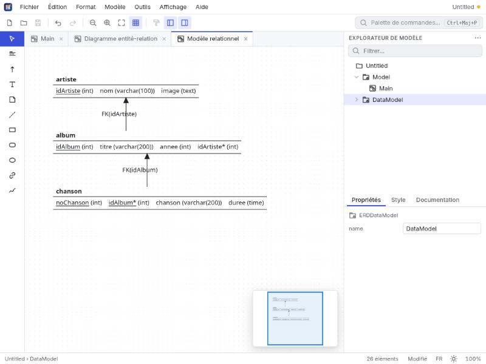

# ConstellaUML

*Créé par **Aïssa Ouameur**.*

Modeleur UML pour Linux et Windows : Tauri 2 + TypeScript + Solid.js, rendu de diagrammes maison (Canvas / SVG), fichiers projet `.mdj`.



## Ce qu'il sait faire

- **Tous les diagrammes UML** : classes, paquetages, objets, structure composite, composants, déploiement, cas d'utilisation, séquence, communication, timing, vue d'ensemble des interactions, activités, états-transitions, profils, flux d'informations.
- **Données** : diagramme entité-relation (pied-de-corbeau), **modèle relationnel** (MLD), **arbre de requête** (algèbre relationnelle, généré depuis une requête SQL), import d'un script SQL, génération du SQL (MySQL/MariaDB, PostgreSQL, SQLite).
- **Code** : génération Java, C#, C++, Python, TypeScript, PHP ; reverse engineering Java, TypeScript, PHP, Python.
- **Édition rapide** (double-clic : visibilité, ajout d'attributs et d'opérations, classes liées), annuler/rétablir illimité, export PNG / JPEG / SVG, thèmes clair et sombre, interface en français et en anglais.

Détail et avancement : [FEATURES.md](FEATURES.md) · architecture : [ARCHITECTURE.md](ARCHITECTURE.md) · bibliothèques utilisées : [LICENSES.md](LICENSES.md).

## Installer

Les paquets sont produits par l'intégration continue à chaque version (`v*`) et publiés dans les **Releases** :

- **Windows 10 et 11** : installeur `ConstellaUML_0.3.0_x64-setup.exe` (ou `ConstellaUML_0.3.0_x64_fr-FR.msi`) ;
- **Linux** (compilés sur Ubuntu 22.04) : AppImage, `.deb`, `.rpm` - Ubuntu 22.04 et plus récent, Debian 12, Arch, Fedora.

 Mode d'emploi : [packaging/LISEZMOI.md](packaging/LISEZMOI.md).

## Développement

Prérequis : Node 20+, Rust stable, et
- Debian / Ubuntu : `libwebkit2gtk-4.1-dev libgtk-3-dev librsvg2-dev build-essential` ;
- Windows : Visual Studio Build Tools (charge de travail « Développement Desktop en C++ ») et WebView2 (déjà présent sur Windows 10/11).

```bash
npm install
npm test               # tests unitaires (Vitest)
npm run check          # types + règles de couches
npm run tauri dev      # application avec rechargement à chaud
npx tauri build        # binaire + paquets (Linux : AppImage/.deb/.rpm, Windows : .exe/.msi) dans src-tauri/target/release/bundle/
packaging/install-local.sh   # installe la version compilée dans ~/.local (menu, icône, .mdj)
```

## Licence

Copyright © 2026 Aïssa Ouameur.

ConstellaUML est un logiciel libre : vous pouvez le redistribuer et le modifier selon les termes de la **GNU General Public License** publiée par la Free Software Foundation, version 3 ou (à votre choix) toute version ultérieure. Il est distribué dans l'espoir d'être utile, mais **sans aucune garantie**. Texte complet : [LICENSE](LICENSE).

Les bibliothèques tierces gardent leur propre licence, toutes compatibles avec la GPL-3.0 ([LICENSES.md](LICENSES.md)).
